# Seaborn 정리 (Capital Bike Share 데이터로)

이번엔 seaborn을 배웠다. matplotlib으로 그래프 그리는 것까진 해 봤는데, seaborn은 같은 그래프를 훨씬 짧게 그릴 수 있어서 편했다.
막대, 선, 점, 상자, 바이올린, 히스토그램, KDE까지 하루에 그래프를 일곱 종류나 그려서 머릿속이 좀 복잡하다. 까먹기 전에 정리해 둔다.

---

## 시작 전에

### seaborn?

matplotlib 위에서 돌아가는 그래프 라이브러리다. 그룹별로 평균을 내거나 색을 나누는 걸 알아서 해 줘서, 데이터 분석할 때 손이 훨씬 덜 간다.

```python
import seaborn as sns
import pandas as pd
import matplotlib.pyplot as plt   # plt.show() 쓰려면 필요
```

처음에 `import seaborn` 했다가 `No module named 'seaborn'`이 떴다. 터미널에서 설치했는데도 계속 안 돼서 한참 헤맸는데, 알고 보니 내 컴퓨터에 파이썬이 두 개(Anaconda, Python 3.13) 깔려 있어서 엉뚱한 쪽에 설치되고 있었다.
노트북 셀에서 `%pip install seaborn`으로 설치하면 지금 노트북이 쓰는 파이썬에 바로 깔린다. 앞으로는 이렇게 하기로.

### 그래프 크기는 한 번만 정해 두자

```python
sns.set_theme(rc={'figure.figsize': (12, 6)}, style='white')
```

가로 12, 세로 6인치에 배경은 흰색. 한 번 실행해 두면 커널을 재시작할 때까지 계속 적용된다.
강의 따라 하면서 셀마다 이 줄을 붙여 넣었는데, 사실 import 밑에 한 번만 쓰면 됐다.
그래프 하나만 크기를 다르게 하고 싶을 땐 그리기 직전에 `plt.figure(figsize=(5, 5))`를 쓰면 된다.

### 데이터

워싱턴DC 공유 자전거 회사(Capital Bike Share)의 2012년 데이터다. 하루가 한 줄이고, 윤년이라 총 366줄.

| 열 | 뜻 |
|---|---|
| `month`, `day` | 월, 일 |
| `quarter` | 분기 (1Q = 1~3월 ... 4Q = 10~12월) |
| `day_of_week` | 요일 (MON ~ SUN) |
| `workingday` | 근무일이면 y, 주말이나 공휴일이면 n |
| `holiday` | 공휴일이면 y |
| `temperature` | 기온 (섭씨) |
| `registered` | 회원 대여 건수 |
| `casual` | 비회원 대여 건수 |
| `total` | 둘을 합친 전체 대여 건수 |

회원과 비회원이 나뉘어 있다는 게 나중에 중요해진다.

```python
df = pd.read_csv('data/bike.csv')
```

seaborn 그래프는 거의 다 이 모양이다.

```python
sns.그래프종류(data=df, x='열 이름', y='열 이름', hue='열 이름')
```

x, y에는 값이 아니라 **열 이름**을 글자로 넣는다. hue는 아래에서 따로 정리했다. 오늘 제일 헷갈렸던 부분이다.

---

## 1. barplot

```python
sns.barplot(data=df, x='month', y='total', errorbar=None, hue='month', legend=False)
plt.show()
```

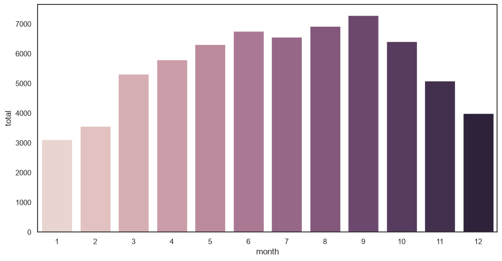

막대 그래프인데, 처음에 놓친 게 하나 있다. **막대 높이가 합계가 아니라 평균이다.**
1월 막대는 1월 1일부터 31일까지 31일치 total의 평균이다. barplot은 x 값이 같은 줄끼리 알아서 묶어서 평균을 낸다.

옵션 두 개를 붙였다.
- `errorbar=None`: 막대 위에 검은 세로선(오차 막대)이 생기는데 지금은 필요 없어서 껐다.
- `hue='month', legend=False`: 강의 화면에서는 막대가 무지개색이었는데 내 건 전부 파란색이었다. seaborn 0.13부터 기본값이 바뀌어서, 색을 나누려면 이렇게 hue를 따로 줘야 한다. 범례는 쓸모없어서 숨겼다.

그래프를 보면 1월이 약 3,100건으로 제일 적고 9월이 약 7,300건으로 제일 많다. 날이 따뜻하면 많이 타는 거다. 여기까지는 예상대로.

### hue

hue가 처음엔 잘 이해가 안 됐다. 그래서 하나씩 뜯어봤다.

```python
sns.barplot(data=df, x='month', y='total', errorbar=None, hue='workingday')
```

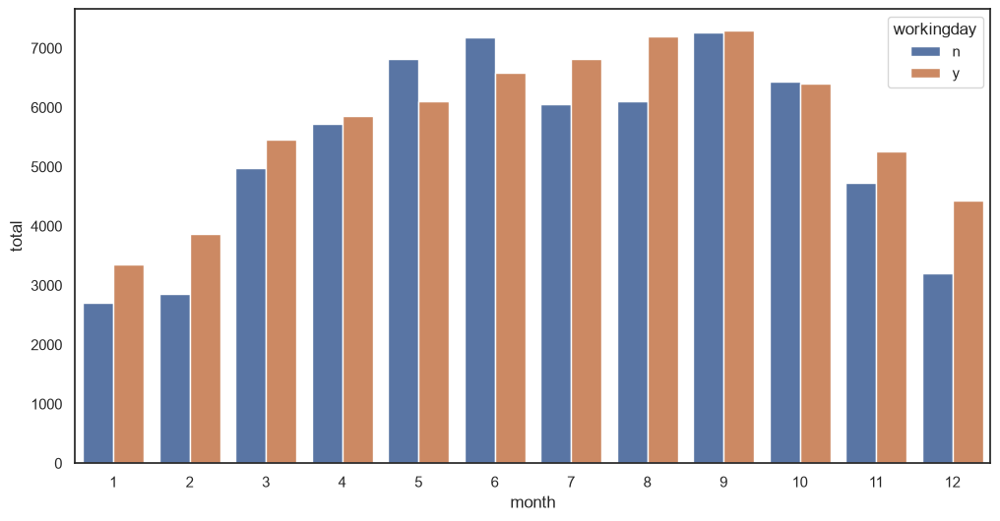

1월만 놓고 보면 이렇게 돌아간다.

1. 1월 31일을 workingday 값으로 나눈다. 근무일(y)인 날들, 쉬는 날(n)인 날들.
2. 두 묶음 각각의 평균을 낸다.
3. 그 평균 두 개를 색을 달리해서 나란히 세운다.

이걸 12달 반복하니까 월마다 막대가 두 개씩 생긴다. 어느 색이 y고 어느 색이 n인지는 오른쪽 범례를 보면 된다.
그러니까 이 그래프는 **같은 달 안에서 두 막대를 비교**하는 그래프다. "근무일이랑 쉬는 날 중에 언제 더 많이 빌릴까?"

그런데 결과가 좀 싱거웠다. 9달은 근무일이 살짝 높고, 5·6·10월은 쉬는 날이 더 높다. 1년 평균으로 보면 근무일 5,700건, 쉬는 날 5,300건 정도라 별 차이가 없다.

### 회원과 비회원으로 나눠 보니

total을 회원과 비회원으로 쪼개 보니 완전히 다른 그림이 나왔다.

```python
sns.barplot(data=df, x='month', y='registered', errorbar=None, hue='workingday')
```

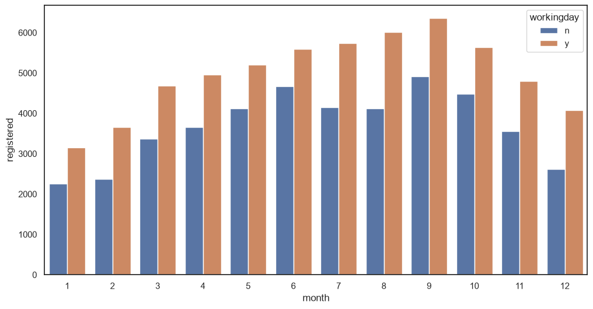

회원은 모든 달에서 근무일이 확실히 높다. 근무일 평균 약 5,000건, 쉬는 날 약 3,700건. 출퇴근할 때 타는 사람들이라는 얘기다.

```python
sns.barplot(data=df, x='month', y='casual', errorbar=None, hue='workingday')
```

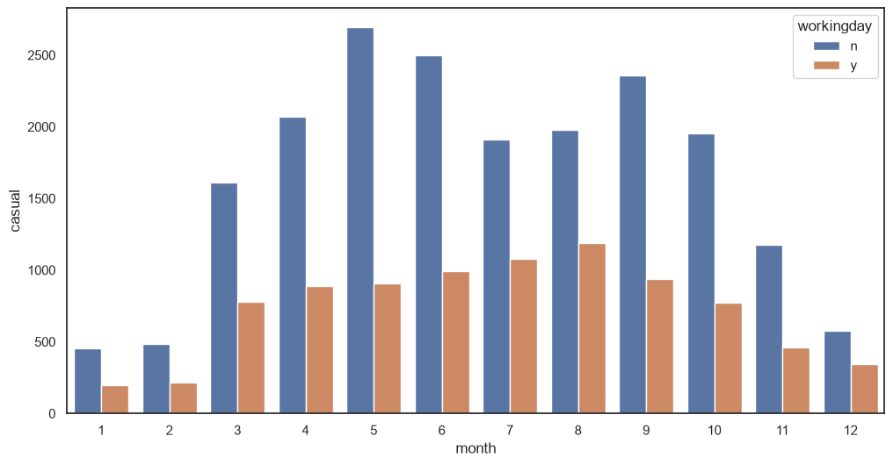

비회원은 정반대다. 모든 달에서 쉬는 날이 훨씬 높고, 달에 따라 2~3배 가까이 차이 난다. 주말에 놀러 나와서 타는 사람들이다.

total에서 차이가 안 보였던 이유가 이거였다. 회원은 근무일에 많이 타고 비회원은 쉬는 날에 많이 타니까, 둘을 합치면 서로 상쇄돼 버린다.
합계만 봤으면 "근무일이든 아니든 별 차이 없네" 하고 넘어갔을 거다. hue랑 y를 이것저것 바꿔 가면서 쪼개 봐야 이런 게 보인다.

### holiday로 바꿔 봤다가

```python
sns.barplot(data=df, x='month', y='casual', errorbar=None, hue='holiday')
```

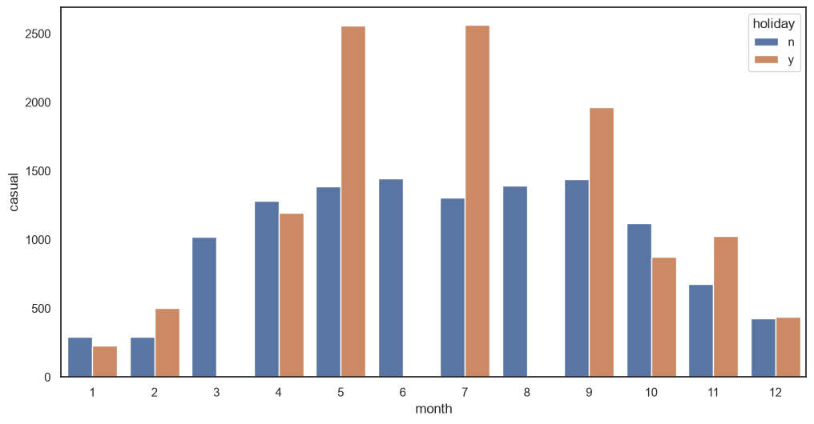

hue를 holiday로 바꿨더니 그래프가 이상하게 나왔다. 3월, 6월, 8월엔 공휴일 막대가 아예 없고, 나머지 달도 들쭉날쭉하다. 5·7월은 공휴일이 두 배쯤 높은데 1·4·10월은 오히려 낮다.

막대가 없는 건 그 달에 공휴일이 하루도 없어서다. 들쭉날쭉한 것도 이유가 같다. 공휴일은 1년에 11일뿐이라 공휴일 막대 하나가 겨우 하루이틀치 평균이다. 그날 비가 왔는지에 따라 값이 확 달라진다.
그래서 이 그래프만 보고 "공휴일엔 비회원이 많이 탄다"고 말하면 안 된다. 묶음 안에 데이터가 너무 적으면 평균은 믿기 어렵다.

(workingday와 holiday가 헷갈렸는데, workingday의 n은 주말+공휴일이고 holiday의 y는 공휴일만이다.)

### 실습: 분기별로

```python
sns.barplot(data=bike_df, x='quarter', y='registered', errorbar=None, hue='workingday')
```

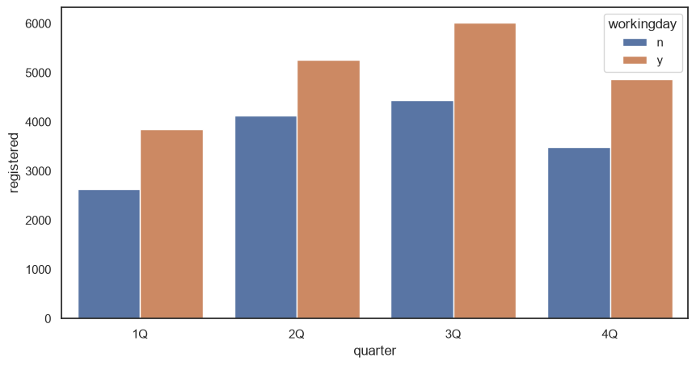

월 대신 분기로 묶었더니 막대가 4묶음뿐이라 훨씬 깔끔하다. 모든 분기에서 회원은 근무일에 1,100~1,600건 정도 더 탄다. 월별로 본 결론이랑 같다.

정리하면 barplot은 그룹끼리 평균을 비교할 때 쓴다. 다만 평균 하나만 보여 주기 때문에, 그 안에서 값이 얼마나 퍼져 있는지는 알 수 없다.

---

## 2. lineplot

```python
sns.lineplot(data=df, x='month', y='casual', errorbar=None, hue='workingday')
```

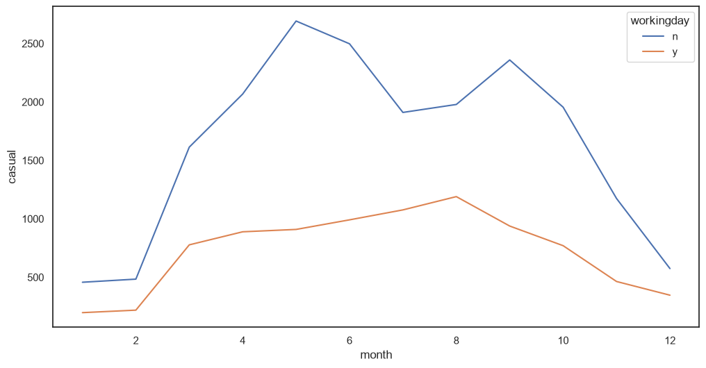

barplot이랑 똑같이 평균을 내는데, 막대 대신 선으로 잇는다. hue를 주면 그룹마다 선이 하나씩 생긴다.

쉬는 날 선이 1년 내내 위에 있고, 4~6월과 9~10월에 간격이 제일 크게 벌어진다. 한여름엔 오히려 조금 좁아진다. 너무 더우면 놀러 나와서도 자전거는 덜 타나 보다.

월, 연도처럼 순서가 있는 x에 쓰는 게 맞다. 지역 이름 같은 걸 선으로 이으면 의미가 없다.

---

## 3. stripplot, swarmplot

barplot은 평균 하나만 보여 주는데, 평균이 같아도 속사정은 다를 수 있다. 이 두 그래프는 데이터를 하나하나 점으로 다 찍는다.

### stripplot

```python
sns.stripplot(data=df, x='month', y='total', hue='workingday')
```

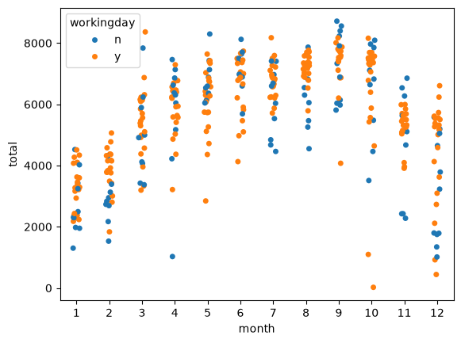

점 하나가 하루다. 한 달 칸에 30개쯤 찍히고, 점 높이가 그날의 대여 건수다.
점들이 한 줄로 겹치지 않게 좌우로 살짝 흩어 놨을 뿐이라, 옆으로 어디 있는지는 의미가 없다.

막대로 볼 땐 몰랐던 게 꽤 보였다.

- 5~10월은 대부분 6,000~7,500 사이에 모여 있고, 1~2월은 2,000~4,000쯤이다.
- 12월은 위아래로 유난히 넓게 퍼져 있다. 크리스마스 전후(12/24~26)에 확 줄어서 그렇다.
- 10월에 혼자 바닥에 붙어 있는 점이 하나 있다. 22건. 뭔가 싶어서 날짜를 찾아보니 2012년 10월 29일, **허리케인 샌디**가 워싱턴DC를 덮친 날이었다.

평균 막대만 봤으면 절대 몰랐을 거다. 이게 제일 재밌었다.

### swarmplot

```python
sns.swarmplot(data=df, x='month', y='total', hue='workingday', size=3)
```

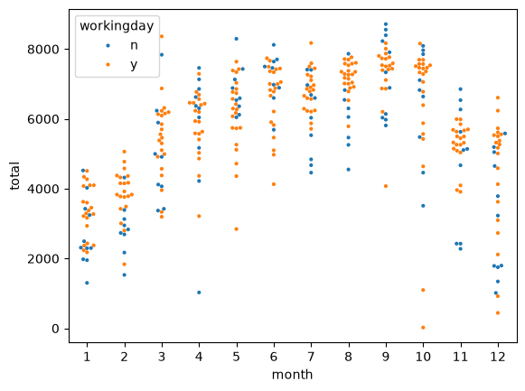

stripplot이랑 거의 같은데, 점끼리 안 겹치게 옆으로 차곡차곡 펼쳐 놓는다. 그래서 옆으로 넓게 퍼진 높이가 "이 값 근처에 날이 많다"는 뜻이 된다. 분포 모양이 stripplot보다 잘 보인다.

처음 그렸을 땐 그래프 위에 경고가 잔뜩 떴다.

```
UserWarning: 6.7% of the points cannot be placed; you may want to decrease the size of the markers or use stripplot.
```

에러는 아니고, 점을 옆으로 펼치다가 칸이 모자라서 몇 개는 제자리에 못 놨다는 뜻이다. `size=3`으로 점 크기를 줄이니까 줄었다. (기본은 5) 그래프를 가로로 더 넓히거나 stripplot으로 바꿔도 된다.

### 실습: 월별 기온

```python
sns.stripplot(data=bike_df, x='month', y='temperature')
```

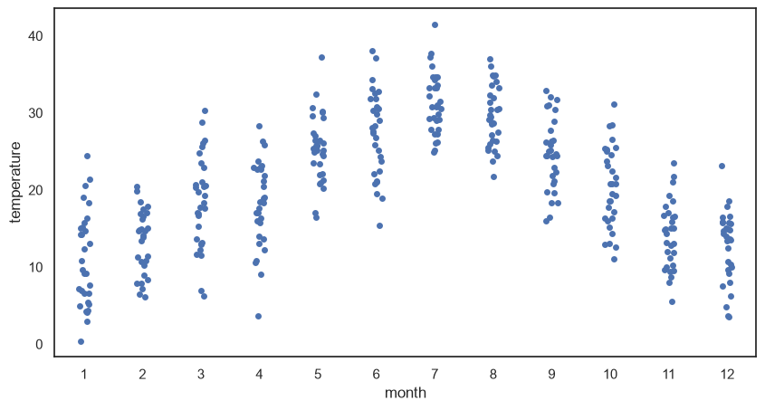

1월 중간값이 9.6도쯤이고 7월이 30.8도로 제일 덥다. 같은 1월인데도 0.4도인 날부터 24.4도인 날까지 있었다. 평균 기온 하나로는 이런 게 안 보인다.
모양이 맨 처음 그린 월별 대여 건수 그래프랑 비슷하다. 따뜻하면 많이 탄다는 게 여기서도 보인다.

### 둘 중 뭘 쓸까

| | stripplot | swarmplot |
|---|---|---|
| 점 배치 | 좌우로 흩뿌림 | 겹치지 않게 펼침 |
| 겹침 | 겹칠 수 있음 | 안 겹침 |
| 분포 모양 | 잘 안 보임 | 잘 보임 |
| 점이 많으면 | 뭉개짐 | 칸을 넘쳐서 경고 |

둘 다 데이터가 수십~수백 개 정도일 때 쓰는 그래프다. 수천 개가 넘어가면 점이 떡져서 알아볼 수가 없다.

---

## 4. boxplot

```python
sns.boxplot(data=df, x='day_of_week', y='registered',
            order=['MON', 'TUE', 'WED', 'THU', 'FRI', 'SAT', 'SUN'])
```

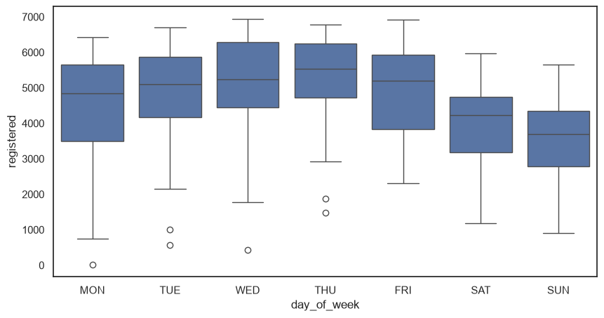

데이터가 퍼진 모양을 상자 하나로 요약한 그래프다. 읽는 법을 그려 두면 이렇다.

```
    o        ← 이상치
    ┬        ← 이상치를 뺀 최댓값
  ┌───┐      ← 75%
  ├───┤      ← 중앙값 (50%)
  └───┘      ← 25%
    ┴        ← 이상치를 뺀 최솟값
    o        ← 이상치
```

값을 작은 순서로 줄 세웠을 때 1/4 지점이 상자 아래, 딱 가운데가 상자 안의 선, 3/4 지점이 상자 위다. 상자 높이가 IQR이고, 가운데 절반의 데이터가 이 안에 들어 있다.
상자에서 IQR의 1.5배보다 더 멀리 떨어진 값은 이상치로 보고 동그라미로 따로 찍어 준다.

`order`는 요일 순서를 정해 준 거다. 안 쓰면 데이터에 나온 순서대로 그려져서 요일이 뒤죽박죽이 된다.

평일 중앙값은 4,800~5,500건쯤이고, 토요일 4,200, 일요일 3,700으로 주말이 낮다. 회원은 출퇴근용이라는 얘기가 여기서도 나온다.

월~목 아래쪽에 이상치가 몇 개 있어서 날짜를 찾아봤다.
- 월요일 20건 → 10월 29일, 또 허리케인 샌디
- 화요일 573건 → 크리스마스
- 수요일 432건 → 크리스마스 다음 날

이상치가 보이면 그날 무슨 일이 있었는지 찾아보는 게 재밌다. 분석은 이런 데서 시작하는 것 같다.

boxplot은 여러 그룹의 분포를 나란히 비교하거나 이상치를 찾을 때 좋다. 데이터가 몇 개든 상자 하나로 줄여 주니까, 점 찍기엔 너무 많을 때도 쓸 수 있다.

---

## 5. violinplot

```python
sns.violinplot(data=df, x='day_of_week', y='registered',
               order=['MON', 'TUE', 'WED', 'THU', 'FRI', 'SAT', 'SUN'])
```

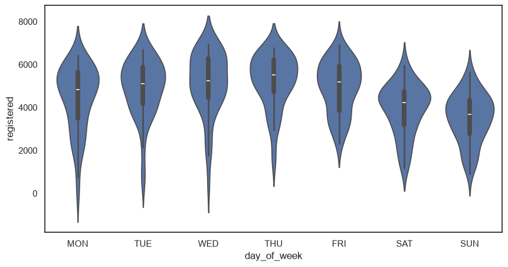

boxplot에 분포 모양을 덧입힌 그래프다. 바이올린이 뚱뚱한 높이일수록 그 값 근처에 날이 많다는 뜻이다.
안쪽을 자세히 보면 작은 boxplot이 들어 있다. 흰 점이 중앙값, 굵은 선이 IQR, 얇은 선이 whisker다.

boxplot은 25/50/75% 위치만 알려 주니까, 데이터가 한 곳에 몰렸는지 두 군데로 갈라졌는지는 알 수 없다. 바이올린은 모양을 그대로 보여 주니까 그게 보인다.

평일, 특히 화~목은 5,000~6,000 근처가 볼록하고 아래로 꼬리가 길게 늘어진다. 그 꼬리가 아까 boxplot의 이상치들이다. 주말은 볼록한 곳이 3,000~4,500 근처로 내려와 있다.

그런데 바이올린이 0 아래까지 내려가 있다. 대여 건수가 마이너스일 리는 없는데? 찾아보니 모양을 부드럽게 그리느라 끝이 조금 삐져나온 거라고 한다. 실제 데이터는 없다.

---

## 6. histplot

```python
plt.figure(figsize=(5, 5))
sns.histplot(data=df, x='registered')
```

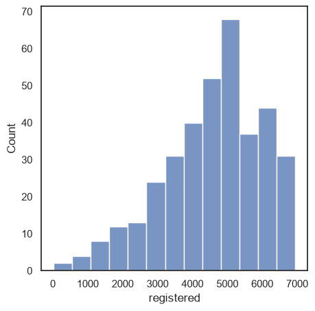

히스토그램은 값 범위를 여러 구간으로 나누고, 구간마다 몇 개가 들어가는지 세서 막대로 그린다. 막대 높이가 날 수다.
처음에 barplot이랑 헷갈렸는데, **barplot은 평균, histplot은 개수**다.

4,000~6,000건 구간이 제일 높으니까, 회원은 대부분 그 정도 빌린다. 왼쪽으로는 꼬리가 길게 이어지고(가끔 확 적은 날), 오른쪽은 7,000 근처에서 뚝 끊긴다.

x 대신 y에 넣으면 막대가 옆으로 눕는다. 내용은 똑같다.

```python
sns.histplot(data=df, y='registered')
```

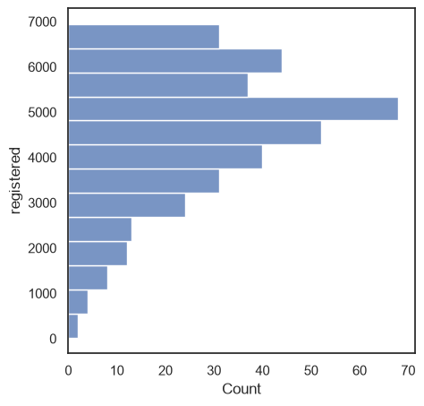

### bins, hue

```python
sns.histplot(data=df, x='registered', bins=10, hue='workingday')
```

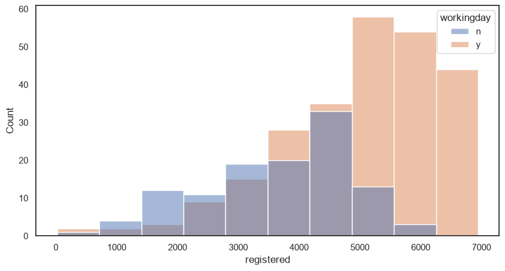

`bins=10`은 구간을 10개로 나눈다는 뜻이다. 너무 적으면 뭉개지고, 너무 많으면 들쭉날쭉해서 오히려 읽기 힘들다.
hue를 주면 근무일과 쉬는 날 히스토그램이 겹쳐서 그려진다.

근무일은 오른쪽(약 4,900~6,900)에 몰려 있고, 쉬는 날은 그보다 왼쪽 가운데쯤에 넓게 퍼져 있다. 쉬는 날 중엔 6,250건을 넘긴 날이 하루도 없다.
근무일 막대가 전체적으로 더 높은 건 근무일(250일)이 쉬는 날(116일)보다 두 배 넘게 많아서다. 그러니 높이 말고 어디에 몰려 있는지를 비교해야 한다.

### 쌓기

```python
sns.histplot(data=df, x='registered', bins=10, hue='workingday', multiple='stack')
```

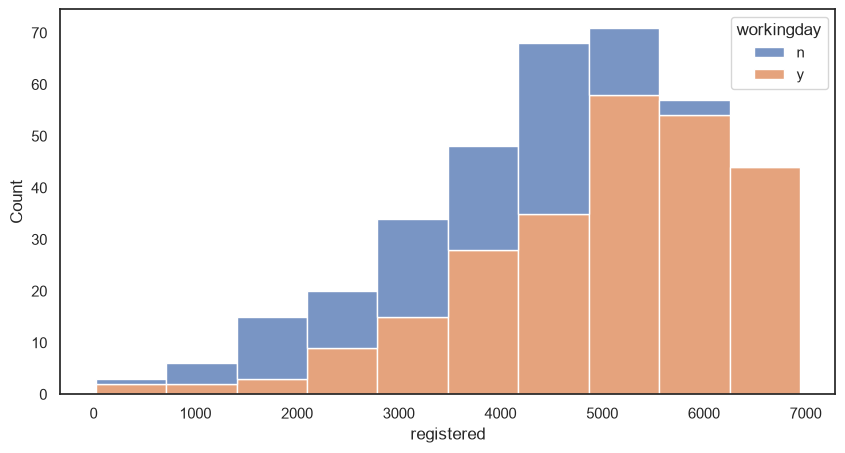

`multiple='stack'`을 주면 겹치지 않고 위로 쌓는다. 막대 전체 높이가 그 구간의 전체 날 수고, 안에서 색이 차지하는 비율이 근무일과 쉬는 날의 비율이다.
오른쪽 구간은 거의 다 근무일 색이다. 많이 빌린 날은 대부분 근무일이었다는 얘기다. 겹친 그래프는 색이 섞여서 헷갈렸는데 이게 더 보기 편했다.

---

## 7. kdeplot

```python
sns.kdeplot(data=df, x='registered', bw_method=0.1)
```

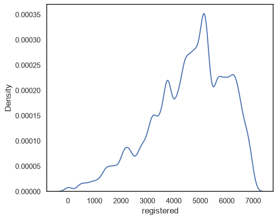

히스토그램을 막대 대신 부드러운 곡선으로 그린 거다. 곡선이 높은 곳에 데이터가 많이 몰려 있다.
y축(Density)은 개수가 아니다. 곡선 아래 넓이를 다 합치면 1이 되게 맞춘 값이라 숫자 자체는 크게 신경 안 써도 되고, 모양만 보면 된다.

`bw_method`는 곡선을 얼마나 부드럽게 할지 정한다. 히스토그램의 bins 같은 역할이다. 0.1처럼 작으면 데이터에 딱 붙어서 울퉁불퉁해지고, 1처럼 크면 매끈해져서 큰 흐름만 남는다.

5,000건 근처가 제일 뾰족하게 솟아 있다. 히스토그램에서 본 것과 같은 얘기다.

---

## 8. 상관관계 시각화

지금까지는 열 하나를 그룹별로 나눠 봤다면, 이번엔 **숫자 열 두 개가 같이 움직이는지** 본다. "기온이 오르면 대여도 늘까?" 같은 질문이다.
상관계수 개념은 [피어슨 상관계수 정리](피어슨%20상관계수%20정리.md)에 따로 정리해 뒀다.

### scatterplot

```python
sns.set_theme(rc={'figure.figsize': (6, 6)}, style='white')
sns.scatterplot(data=df, x='temperature', y='total')
plt.show()
```

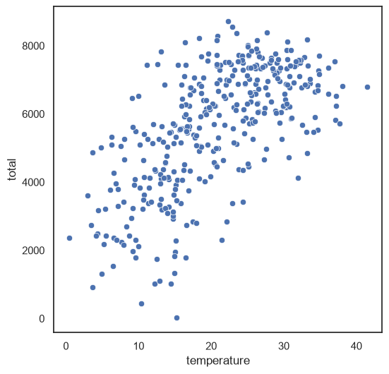

산점도다. 점 하나가 하루고, x가 그날 기온, y가 그날 대여 건수다. 점들이 오른쪽 위로 올라가면 양의 상관관계, 오른쪽 아래로 내려가면 음의 상관관계다.

기온이 오를수록 점들이 확실히 위로 올라간다. 10도 이하인 날은 평균 약 3,400건인데, 25~30도인 날은 약 6,800건으로 두 배다.
그런데 30도를 넘어가면 더 안 늘고 살짝 줄어든다. lineplot에서 한여름에 간격이 좁아졌던 거랑 같은 얘기 같다. 너무 더우면 덜 탄다.

### regplot

```python
sns.regplot(data=df, x='temperature', y='total')
```

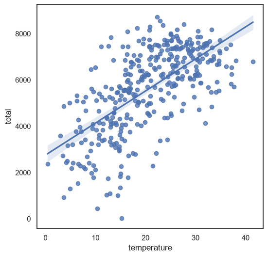

산점도에 **추세선**(회귀선)을 하나 그어 준다. 점만 있으면 "대충 올라가네" 정도인데, 선이 있으니까 방향이랑 기울기가 한눈에 보인다.
선 주변의 연한 띠는 신뢰구간이다. 추세선이 이 안에 있을 가능성이 높다는 뜻이고, 띠가 좁을수록 추세가 확실하다는 얘기다.

기온은 선이 오른쪽 위로 뚜렷하게 올라간다. 점들도 선 주변에 꽤 모여 있다.

풍속이랑 습도도 그려 봤다.

```python
sns.regplot(data=df, x='windspeed', y='total')
sns.regplot(data=df, x='humidity', y='total')
```

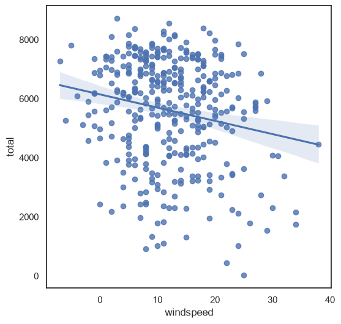

풍속은 선이 오른쪽 아래로 살짝 내려간다. 바람이 세면 조금 덜 탄다. 그런데 점들이 위아래로 너무 넓게 퍼져 있어서 풍속만 보고 대여 건수를 맞히긴 어렵겠다.
구간을 나눠 평균을 내 보니 풍속 20 이하에서는 5,700~5,900건으로 비슷하다가 20을 넘으면 약 4,700건으로 뚝 떨어졌다. 바람이 **아주 셀 때만** 영향이 있는 거다.

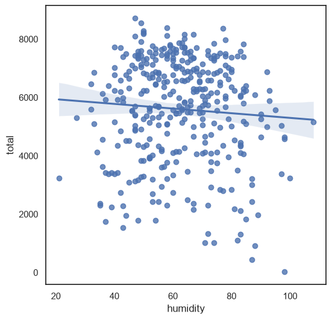

습도는 선이 거의 평평하다. 처음엔 "습도는 상관없구나" 하고 넘어가려 했는데, 구간별로 평균을 내 보니 아니었다.

| 습도 | 평균 대여 건수 |
|---|---|
| 40 이하 (너무 건조) | 약 4,700 |
| 40~80 | 약 5,800~5,900 |
| 80 초과 (너무 습함) | 약 4,500 |

가운데가 볼록한 **곡선 관계**였다. 적당할 때 제일 많이 타고 양 끝으로 가면 줄어든다. 직선을 하나 그으면 양쪽이 서로 상쇄돼서 평평하게 나온 거다. 회원/비회원이 합계 안에서 서로 지워졌던 거랑 비슷한 느낌이다.

바닥에 붙은 점(습도 98, 22건)은 또 허리케인 샌디 날이었다.
그리고 습도가 108인 날(12월 10일)이 있다. 습도가 100%를 넘을 순 없을 텐데... 데이터 입력 오류 같다.

### corr()로 숫자 보기

```python
df.corr(numeric_only=True)
```

그래프 말고 숫자로 보고 싶으면 `corr()`을 쓴다. 숫자 열끼리 짝지어서 피어슨 상관계수를 표로 전부 계산해 준다.
`numeric_only=True`는 숫자 열만 계산하라는 거다. `quarter`, `day_of_week` 같은 글자 열은 계산을 못 한다.

표 읽는 법은 간단하다. 행과 열이 만나는 칸이 그 두 열의 상관계수다. 대각선은 자기 자신이랑 비교한 거라 전부 1이고, 대각선을 기준으로 대칭이다.

total 줄만 뽑아 보면 이렇다.

| 열 | 상관계수 | |
|---|---|---|
| temperature | **0.64** | 꽤 강한 양의 관계 |
| windspeed | -0.19 | 약한 음의 관계 |
| humidity | -0.07 | 직선 관계는 거의 없음 (위에서 본 함정) |
| registered | 0.91 | |
| casual | 0.64 | |

registered랑 casual이 높게 나오는 건 당연하다. total이 그 둘을 더한 거니까. 분석 의미는 별로 없다.

### heatmap

```python
sns.heatmap(df.corr(numeric_only=True), annot=True)
```

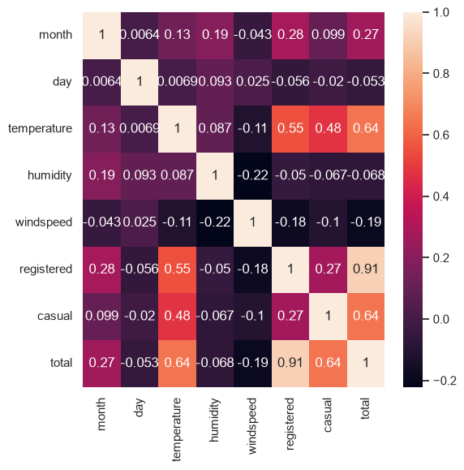

위의 숫자 표를 색으로 칠한 거다. `annot=True`를 주면 칸마다 숫자도 같이 써 준다.
밝을수록 양의 상관관계가 강하고, 어두울수록 음의 쪽이다. 오른쪽 색 막대를 보면 된다.

열이 8개라 표로 보면 숫자 64개를 읽어야 하는데, 히트맵은 밝은 칸만 찾으면 된다. temperature 줄에서 total, registered, casual 칸이 밝다. 날씨 중엔 기온이 제일 중요하다는 게 바로 보인다.

(노트북에선 `bike_df`로 그렸는데 `df`랑 같은 파일이라 결과는 같다. 다만 실습 셀을 안 돌리고 이 셀만 돌리면 `bike_df`가 없다고 에러가 난다.)

### 상관계수만 믿으면 안 된다

습도에서 제대로 배웠다. 피어슨 상관계수는 **직선 관계만** 잡는다. 곡선 관계는 진짜 관계가 있어도 0 근처로 나온다.
그래서 순서는 이렇게 하기로.

1. `scatterplot`이나 `regplot`으로 모양부터 본다.
2. `corr()`로 숫자를 확인한다.
3. 열이 많으면 `heatmap`으로 한눈에 본다.
4. 상관계수가 0 근처여도 그래프가 이상하면 구간을 나눠서 평균을 내 본다.

---

## 언제 뭘 쓰나

헷갈릴 때 보려고 표로 정리했다.

| 보고 싶은 것 | 그래프 |
|---|---|
| 그룹별 평균 비교 | `barplot` |
| 시간에 따른 흐름 | `lineplot` |
| 데이터를 하나하나 (적을 때) | `stripplot` |
| 하나하나 + 어디에 몰렸는지 (적을 때) | `swarmplot` |
| 그룹별 퍼진 정도, 이상치 | `boxplot` |
| 그룹별 퍼진 정도 + 분포 모양 | `violinplot` |
| 열 하나의 분포 (구간별 개수) | `histplot` |
| 분포를 부드러운 곡선으로 | `kdeplot` |
| 숫자 열 두 개의 관계 | `scatterplot` |
| 관계 + 추세선 | `regplot` |
| 여러 열의 상관계수를 한눈에 | `heatmap` + `corr()` |

데이터가 수십~수백 개면 strip이나 swarm으로 하나하나 찍어 보고, 그보다 많으면 box, violin, hist, kde로 요약해서 보면 된다.

---

## 헤맸던 것들

| 문제 | 해결 |
|---|---|
| `No module named 'seaborn'` | 터미널 말고 노트북 셀에서 `%pip install seaborn` |
| 막대가 무지개색이 아님 | seaborn 0.13부터 바뀜. `hue='x축 열', legend=False` |
| swarmplot에서 UserWarning | `size=3`으로 점 크기 줄이기 |
| 요일 순서가 뒤죽박죽 | `order=['MON', ..., 'SUN']` |
| 그래프 위에 `<Axes: >` | 마지막 줄에 `plt.show()` |
| `corr()`에서 문자 열 때문에 에러 | `numeric_only=True` |

---

## 마무리

그래프 종류보다 더 기억에 남는 건 이거다.

- barplot이랑 lineplot은 평균이다. 평균만 보면 속을 모른다.
- 합계만 보지 말고 쪼개 볼 것. 회원/비회원처럼 반대로 움직이는 게 합계 안에서 서로 지워져 있을 수 있다.
- 묶음 안에 데이터가 몇 개 없으면 그 평균은 믿지 말 것. (공휴일 11일)
- 튀는 점이 보이면 그날 무슨 일이 있었는지 찾아볼 것. 허리케인 샌디처럼 생각지도 못한 게 나온다.
- 상관계수가 0이라고 관계가 없는 게 아니다. 직선이 아닐 뿐일 수 있으니 그래프로 꼭 확인할 것. (습도)
