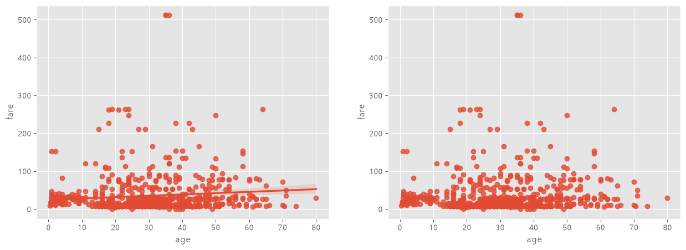
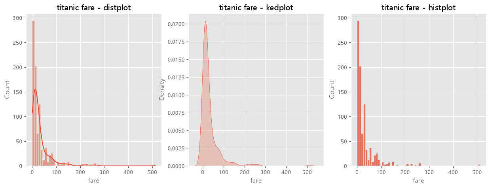
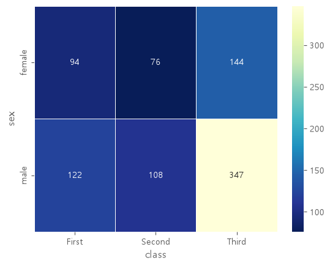
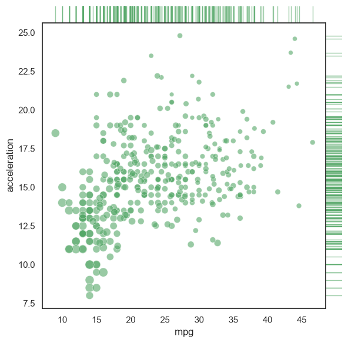
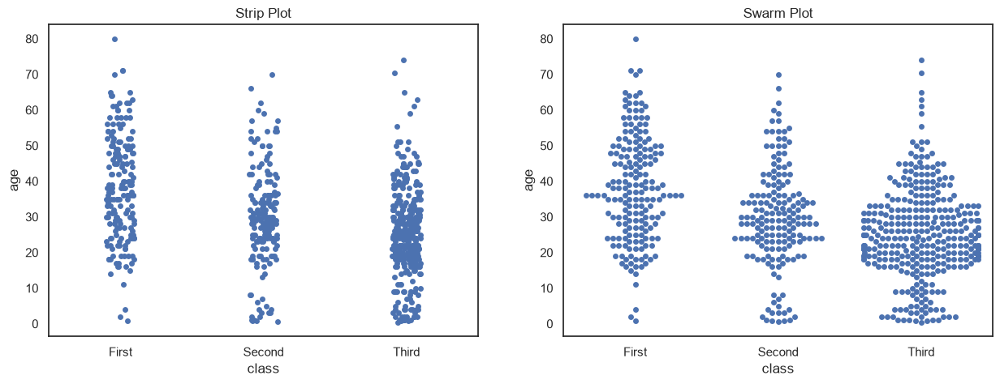
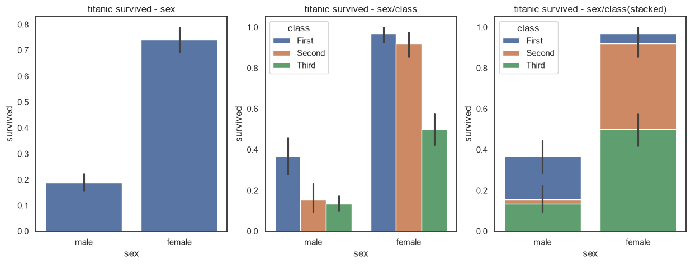
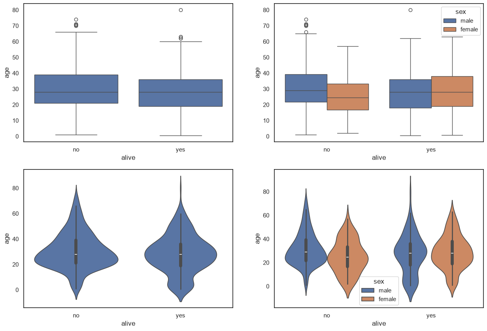

# seaborn · folium 시각화 정리

> 지난 글에서는 pandas 의 `plot()` 과 matplotlib 으로 그래프를 그렸다.
> 이번 글은 그 다음 단계다. **seaborn 으로 통계 그래프**를 그리고, **folium 으로 지도 위에 데이터**를 올린다.
> 회귀선 산점도 · 히스토그램/KDE · 히트맵 · 범주형 산점도 · 막대 · 박스/바이올린 그래프, 그리고 지도 마커까지 다룬다.

- 실습 환경 : Python, pandas, matplotlib, seaborn, folium, Jupyter Notebook(VS Code)
- 실습 데이터 : seaborn 내장 `titanic`, `mpg` / `서울지역 대학교 위치.xlsx` / `국가철도공단_경의중앙선_역위치_20250630.csv`
- 화면 분할(`fig.add_subplot`), 제목(`ax.set_title`) 같은 matplotlib 문법은 지난 글에서 정리했으므로 여기서는 다시 설명하지 않는다.

---

## 목차

1. 먼저 알아 둘 큰 그림
2. seaborn 준비 : import 와 예제 데이터
3. seaborn 그래프 종류별 정리
4. folium 으로 지도 그리기
5. 내가 만난 에러와 함정 모음
6. 한눈에 요약 (치트시트)

---

## 1. 먼저 알아 둘 큰 그림

| 도구 | 한 줄 설명 | 결과물 |
|---|---|---|
| seaborn | matplotlib 위에 만든 **통계 그래프** 라이브러리 | 그림 (matplotlib 과 같다) |
| folium | **지도** 위에 데이터를 올리는 라이브러리 | HTML (마우스로 움직이고 확대할 수 있다) |

### 가장 중요한 규칙 3가지

1. **seaborn 은 "데이터프레임 + 열 이름"으로 그린다.**
   `sns.그래프함수(data=df, x='열 이름', y='열 이름')` 모양이 거의 모든 함수에 똑같이 쓰인다.
2. **seaborn 그래프도 matplotlib 그래프다.** `ax=` 로 그릴 칸을 정하고, `ax.set_title()`, `plt.show()` 로 마무리한다.
3. **folium 좌표는 `[위도, 경도]` 순서다.** 그리고 만든 것은 `.add_to(지도)` 를 해야 지도에 올라간다.

---

## 2. seaborn 준비 : import 와 예제 데이터

```python
import seaborn as sns            # 보통 sns 로 줄여 쓴다
import matplotlib.pyplot as plt

titanic = sns.load_dataset('titanic')
print(titanic.head())
print('\n')
print(titanic.info())
```

```
   survived  pclass     sex   age  sibsp  parch     fare embarked  class    who ...
0         0       3    male  22.0      1      0   7.2500        S  Third    man ...
1         1       1  female  38.0      1      0  71.2833        C  First  woman ...

RangeIndex: 891 entries, 0 to 890
 #   Column       Non-Null Count  Dtype
 0   survived     891 non-null    int64
 3   age          714 non-null    float64
 11  deck         203 non-null    category
 ...
```

- `sns.load_dataset('이름')` : seaborn 이 제공하는 연습용 데이터를 데이터프레임으로 가져온다. **인터넷에서 내려받기 때문에** 처음에는 인터넷 연결이 필요하다.
- `titanic.info()` : 열마다 자료형과 **비어 있지 않은 값의 개수**를 보여 준다. 전체 891행인데 `age` 는 714개, `deck` 은 203개뿐이다. 빈칸(결측값)이 있다는 뜻이다.

### 이 글에서 쓰는 타이타닉 열

| 열 | 뜻 |
|---|---|
| `survived` | 생존 여부 (0 = 사망, 1 = 생존) |
| `alive` | 생존 여부를 글자로 (`yes` / `no`) |
| `sex` | 성별 |
| `age` | 나이 |
| `fare` | 요금 |
| `class` | 객실 등급 (`First` / `Second` / `Third`) |

### seaborn 함수의 공통 모양

```python
sns.그래프함수(data=데이터프레임, x='x축 열 이름', y='y축 열 이름', hue='색으로 나눌 열', ax=그릴 칸)
```

| 옵션 | 뜻 |
|---|---|
| `data` | 그릴 데이터프레임 |
| `x`, `y` | 축에 놓을 **열 이름** (글자로 쓴다) |
| `hue` | 이 열의 값에 따라 **색으로 한 번 더 나눈다** |
| `ax` | 그릴 칸. `fig.add_subplot()` 으로 만든 것을 넣는다 |

matplotlib 에서는 `df[df['origin'] == 1]['mpg']` 처럼 데이터를 직접 잘라서 넣어야 했다.
seaborn 은 열 이름만 알려 주면 **알아서 나눠서** 그린다. 이게 가장 큰 차이다.

---

## 3. seaborn 그래프 종류별 정리

### 3-1. 회귀선이 있는 산점도 (regplot)

```python
fig = plt.figure(figsize=(15, 5))
ax1 = fig.add_subplot(1, 2, 1)
ax2 = fig.add_subplot(1, 2, 2)

# 왼쪽 : 선형회귀선 표시 (fit_reg=True 가 기본값)
sns.regplot(x='age', y='fare', data=titanic, ax=ax1)

# 오른쪽 : 선형회귀선 미표시
sns.regplot(x='age', y='fare', data=titanic, ax=ax2, fit_reg=False)

plt.show()
```



- `regplot` = **reg**ression(회귀) + plot. 산점도를 그리고 그 위에 **회귀선**을 겹쳐 준다.
- **회귀선** = 점들의 흐름을 가장 잘 나타내는 직선

| 회귀선 모양 | 뜻 |
|---|---|
| 오른쪽 위로 올라간다 | x 가 커지면 y 도 커진다 (양의 관계) |
| 오른쪽 아래로 내려간다 | x 가 커지면 y 는 작아진다 (음의 관계) |
| 거의 평평하다 | 관계가 거의 없다 |

- 선 주변의 **옅은 띠**는 신뢰구간이다. "진짜 선은 대략 이 범위 안에 있을 것" 이라는 뜻이고, 띠가 넓을수록 불확실하다.
- `fit_reg=False` : 회귀선 없이 점만 찍는다.
- 읽는 법 : 회귀선이 거의 평평하다 → **나이가 많다고 요금을 더 낸 것은 아니다.**

### 3-2. 히스토그램 / 커널 밀도 그래프 (histplot, kdeplot)

```python
# 그래프 객체 생성 : 1행 3열 → 그래프 3개
fig = plt.figure(figsize=(15, 5))
ax1 = fig.add_subplot(1, 3, 1)
ax2 = fig.add_subplot(1, 3, 2)
ax3 = fig.add_subplot(1, 3, 3)

sns.histplot(data=titanic, x='fare', kde=True, ax=ax1)    # 히스토그램 + KDE 곡선
sns.kdeplot(data=titanic, x='fare', fill=True, ax=ax2)    # KDE 곡선만
sns.histplot(data=titanic, x='fare', ax=ax3)              # 히스토그램만

ax1.set_title('titanic fare - histplot + kde')
ax2.set_title('titanic fare - kdeplot')
ax3.set_title('titanic fare - histplot')

plt.show()
```



변수 **하나**가 어떻게 퍼져 있는지(분포) 볼 때 쓴다. 그래서 `x` 만 준다.

| 함수 | 그리는 것 |
|---|---|
| `sns.histplot(..., kde=True)` | 히스토그램 + 밀도 곡선 |
| `sns.kdeplot(..., fill=True)` | 밀도 곡선만. `fill=True` 면 곡선 아래를 색칠한다 |
| `sns.histplot(...)` | 히스토그램만 |

**KDE 란?** **K**ernel **D**ensity **E**stimate(커널 밀도 추정). 히스토그램을 **부드러운 곡선**으로 바꾼 것이라고 생각하면 된다.

- 히스토그램은 구간을 몇 개로 나누느냐에 따라 모양이 달라진다. KDE 는 매끄러운 곡선이라 전체 모양을 보기 좋다.
- **곡선이 높은 곳 = 데이터가 많이 몰린 곳**
- 읽는 법 : 요금은 대부분 0 ~ 50 사이에 몰려 있고, 아주 비싼 요금을 낸 사람이 조금 있어 오른쪽으로 꼬리가 길다.

> 💡 예전 교재에는 `sns.distplot()` 이 나온다. 히스토그램과 KDE 를 같이 그리던 함수인데 지금은 없어졌다.
> 같은 그림은 `sns.histplot(kde=True)` 로 그린다.

### 3-3. 히트맵 (heatmap) — `pivot_table` 로 표부터 만들기

히트맵은 **표의 숫자를 색의 진하기로** 나타낸 그래프다. 그래서 먼저 표를 만들어야 한다.

```python
# 성별(행) × 객실 등급(열) 로 묶어서 사람 수 세기
table = titanic.pivot_table(index=['sex'], columns=['class'], aggfunc='size')
table
```

```
class   First  Second  Third
sex
female     94      76    144
male      122     108    347
```

**피벗 테이블이란?** 두 가지 기준으로 데이터를 묶어 요약한 표다. 엑셀의 피벗 테이블과 같다.

| 옵션 | 뜻 |
|---|---|
| `index=['sex']` | **행**에 놓을 기준 |
| `columns=['class']` | **열**에 놓을 기준 |
| `aggfunc='size'` | 칸마다 계산할 방법. `'size'` = 그 칸에 해당하는 **행의 개수** |

- "여성이면서 1등석" 인 사람이 94명이라는 식으로 읽는다.
- `aggfunc` 에는 `'mean'`, `'sum'`, `'max'` 등도 쓸 수 있다. 그때는 `values='열 이름'` 으로 **무엇을** 계산할지도 정한다.
  예) `titanic.pivot_table(index='sex', columns='class', values='age', aggfunc='mean')` → 성별·등급별 평균 나이

```python
sns.heatmap(table,                  # 표(데이터프레임)
            annot=True, fmt='d',    # 칸에 숫자 표시, 정수 형식
            cmap='YlGnBu_r',        # 색 조합
            linewidth=.5,           # 칸 사이 구분선 굵기
            cbar=True)              # 옆의 색 막대 표시 여부

plt.show()
```



| 옵션 | 뜻 |
|---|---|
| `annot=True` | 칸 안에 숫자를 적는다 (**annot**ation) |
| `fmt='d'` | 숫자 형식. `'d'` = 정수, `'.1f'` = 소수 1자리 |
| `cmap` | 색 조합 (**c**olor**map**) |
| `linewidth` | 칸 사이 구분선 굵기 |
| `cbar` | 옆에 색 기준 막대(**c**olor **bar**)를 표시할지 |

**`cmap='YlGnBu_r'` 읽는 법**

| 부분 | 뜻 |
|---|---|
| `YlGnBu` | **Y**e**l**low → **G**ree**n** → **Bu**(Blue). 값이 작으면 노랑, 크면 파랑 |
| `_r` | **r**everse. 순서를 뒤집는다 → 값이 클수록 연한 노랑 |

- 다른 색 조합 : `'Blues'`, `'Reds'`, `'coolwarm'`, `'viridis'` 등. 어느 것이든 `_r` 을 붙이면 뒤집힌다.
- 읽는 법 : 3등석 남성 칸(347명)이 다른 칸보다 훨씬 많아 색이 확 다르다.

### 3-4. JointGrid — 산점도와 분포를 한 번에

```python
sns.set_theme(style="white", color_codes=True)
mpg = sns.load_dataset("mpg")

# ① 틀 만들기 : 가운데 큰 칸 + 위·오른쪽 가장자리 칸
g = sns.JointGrid(data=mpg, x="mpg", y="acceleration", space=0, ratio=17)

# ② 가운데 칸 : 산점도 (점 크기 = 마력)
g.plot_joint(sns.scatterplot, size=mpg["horsepower"], sizes=(30, 120),
             color="g", alpha=.6, legend=False)

# ③ 가장자리 칸 : 러그 플롯 (데이터 하나마다 짧은 선)
g.plot_marginals(sns.rugplot, height=1, color="g", alpha=.6)
```



seaborn 공식 예제를 따라 해 본 것이다. **가운데에 두 변수의 관계**, **가장자리에 각 변수의 분포**를 함께 그린다.

| 코드 | 하는 일 |
|---|---|
| `sns.set_theme(style="white")` | seaborn 전체 테마 설정. `"white"` = 격자 없는 흰 배경 |
| `color_codes=True` | `"g"`(초록), `"r"`(빨강) 같은 한 글자 색 이름을 seaborn 색으로 쓴다 |
| `sns.JointGrid(...)` | 틀만 만든다. 이 단계에서는 그림이 없다 |
| `space=0` | 가운데 칸과 가장자리 칸 사이 간격 |
| `ratio=17` | 가운데 칸이 가장자리 칸보다 몇 배 큰지 |
| `g.plot_joint(함수, 옵션...)` | **가운데 칸**에 그린다 |
| `g.plot_marginals(함수, 옵션...)` | **가장자리 칸**에 그린다 |

- `size=mpg["horsepower"]` : 점 크기를 마력에 따라 다르게 한다. `sizes=(30, 120)` 은 점 크기의 최소 · 최대 범위
- `sns.rugplot` : 데이터 하나마다 짧은 선을 긋는다. **선이 촘촘한 곳 = 데이터가 몰린 곳**

> 💡 **함수 이름 뒤에 괄호가 없다.** `g.plot_joint(sns.scatterplot, ...)` 에서 `sns.scatterplot()` 이 아니라 `sns.scatterplot` 이다.
> 내가 직접 실행하는 것이 아니라 "이 함수로 그려 줘" 하고 **함수 자체를 건네주는 것**이다. 실제 실행은 JointGrid 가 한다.

> ⚠️ **`sns.set_theme()` 은 그 뒤의 모든 그래프에 계속 적용된다.** 글꼴 설정도 기본값으로 되돌아가서
> 한글이 다시 □□□ 로 깨진다. 한글을 쓰려면 `set_theme()` **뒤에** `rc('font', family=font_name)` 을 다시 실행한다.

### 3-5. 범주형 데이터의 산점도 (stripplot, swarmplot)

```python
fig = plt.figure(figsize=(15, 5))
ax1 = fig.add_subplot(1, 2, 1)
ax2 = fig.add_subplot(1, 2, 2)

# 왼쪽 : 점이 겹쳐도 그대로 찍는다
sns.stripplot(x="class", y="age", data=titanic, ax=ax1)

# 오른쪽 : 점이 겹치지 않게 옆으로 벌려 찍는다
sns.swarmplot(x="class", y="age", data=titanic, ax=ax2)

ax1.set_title('Strip Plot')
ax2.set_title('Swarm Plot')

plt.show()
```



x축이 숫자가 아니라 등급 같은 **범주**(종류)일 때, 범주마다 값이 어떻게 흩어져 있는지 점으로 보여 준다.
점 하나 = 승객 1명이다.

| 함수 | 특징 |
|---|---|
| `stripplot` | 범주 위에 좁은 띠 모양으로 찍는다. 값이 비슷하면 **점이 겹친다** |
| `swarmplot` | 점이 **겹치지 않게** 옆으로 벌린다. 옆으로 넓게 퍼진 곳 = 데이터가 많은 곳 |

- 분포를 보기에는 `swarmplot` 이 낫다. 다만 데이터가 많으면 점을 다 못 찍거나(경고가 난다) 그리는 데 오래 걸린다.
- 읽는 법
  - 1등석 : 40 ~ 50대 중심. 70 ~ 80세 고령 승객도 있고 어린 승객은 적다 → 경제적 여유가 있는 중장년층
  - 2등석 : 20 ~ 40대 중심. 어린이가 조금 있다 → 중산층 가족
  - 3등석 : 10 ~ 30대 중심. 어린이 비율이 높고 가장 젊다 → 노동자 · 이민자 가족

### 3-6. 막대 그래프 (barplot) — 막대 높이가 "평균"이다

```python
fig = plt.figure(figsize=(15, 5))
ax1 = fig.add_subplot(1, 3, 1)
ax2 = fig.add_subplot(1, 3, 2)
ax3 = fig.add_subplot(1, 3, 3)

sns.barplot(x='sex', y='survived', data=titanic, ax=ax1)                             # 성별
sns.barplot(x='sex', y='survived', hue='class', data=titanic, ax=ax2)                # 성별 안에서 등급별
sns.barplot(x='sex', y='survived', hue='class', dodge=False, data=titanic, ax=ax3)   # 같은 자리에 겹쳐서

ax1.set_title('titanic survived - sex')
ax2.set_title('titanic survived - sex/class')
ax3.set_title('titanic survived - sex/class(dodge=False)')

plt.show()
```



**pandas 막대 그래프와 가장 다른 점** : pandas `plot(kind='bar')` 는 표의 값을 그대로 막대 높이로 쓴다.
seaborn `barplot` 은 범주별로 **평균을 직접 계산해서** 그린다.

| 부분 | 뜻 |
|---|---|
| 막대 높이 | 그 범주의 `y` 값 **평균** |
| 막대 위의 검은 세로선 | **오차 막대**. 평균의 95% 신뢰구간. 길수록 그 평균이 불확실하다 |
| `hue='class'` | 막대를 등급에 따라 색으로 한 번 더 나눈다 |
| `dodge=False` | 나눈 막대를 옆으로 나란히 놓지 않고 **같은 자리에 겹친다** (기본값 `True` = 나란히) |

- `survived` 는 0 또는 1 이다. **0 과 1 의 평균은 곧 비율**이다. (10명 중 7명이 1 이면 평균 0.7)
  그래서 이 그래프의 막대 높이는 **생존율**이다.
- 읽는 법 : 여성 생존율(약 74%)이 남성(약 19%)보다 훨씬 높다. 성별이 같으면 등급이 높을수록 생존율이 높다. 여성 1 · 2등석은 90% 를 넘는데 3등석은 50% 정도다.

> ⚠️ **`dodge=False` 는 누적(stacked) 그래프가 아니다.** 값을 위로 쌓은 것이 아니라 같은 자리에 겹쳐 그린 것이다.
> 막대 전체 높이를 합계로 읽으면 안 된다. 색마다 **꼭대기 높이**가 그 등급의 생존율이다.
> (원래 실습 코드의 제목은 `stacked` 였는데, 헷갈리지 않게 이 글에서는 `dodge=False` 로 바꿔 적었다. 그림에는 원래 제목이 남아 있다.)

> 💡 평균 말고 **개수**를 막대로 그리려면 `sns.countplot(x='sex', data=titanic)` 을 쓴다.

### 3-7. 박스 플롯 / 바이올린 그래프 (boxplot, violinplot)

```python
fig = plt.figure(figsize=(15, 10))
ax1 = fig.add_subplot(2, 2, 1)
ax2 = fig.add_subplot(2, 2, 2)
ax3 = fig.add_subplot(2, 2, 3)
ax4 = fig.add_subplot(2, 2, 4)

sns.boxplot(x='alive', y='age', data=titanic, ax=ax1)                  # 박스 - 기본
sns.boxplot(x='alive', y='age', hue='sex', data=titanic, ax=ax2)       # 박스 - 성별로 나눔
sns.violinplot(x='alive', y='age', data=titanic, ax=ax3)               # 바이올린 - 기본
sns.violinplot(x='alive', y='age', hue='sex', data=titanic, ax=ax4)    # 바이올린 - 성별로 나눔

plt.show()
```



- `sns.boxplot` : 지난 글의 박스 플롯과 같은 그림이다. 다만 `x='alive'` 만 주면 **알아서 범주별로 나눠** 그린다.
- `sns.violinplot` : **박스 플롯 + KDE**. 밀도 곡선을 세로로 세워 좌우 대칭으로 붙인 모양이라 바이올린처럼 보인다.

**바이올린 그래프 읽는 법**

```
        ╱╲
       ╱  ╲         ← 폭이 좁다 = 이 값을 가진 데이터가 적다
      ╱ ┃  ╲
     │  ┃   │       ← 폭이 넓다 = 이 값을 가진 데이터가 많다
     │  █   │       ← 굵은 막대 = 박스 플롯의 상자 (25% ~ 75%)
     │  ●   │       ← 점(또는 선) = 중앙값
     │  █   │
      ╲ ┃  ╱
       ╲  ╱
        ╲╱
```

| | 박스 플롯 | 바이올린 그래프 |
|---|---|---|
| 잘 보이는 것 | 중앙값, 사분위수, 이상치 같은 **요약 숫자** | 값이 어디에 몰려 있는지 **분포의 모양** |
| 약점 | 봉우리가 2개인 분포를 구분하지 못한다 | 이상치가 따로 표시되지 않는다 |

> 💡 `hue` 가 두 가지 값뿐이면 `sns.violinplot(..., hue='sex', split=True)` 로 바이올린 **반쪽씩** 붙여 그릴 수 있다. 비교가 더 쉽다.

---

## 4. folium 으로 지도 그리기

folium 은 지도 위에 데이터를 표시하는 라이브러리다. 결과물이 그림 파일이 아니라 **HTML** 이라서 마우스로 움직이고 확대 · 축소할 수 있다.

```python
%pip install folium    # 처음 한 번만
```

### 4-1. 지도 만들기와 저장

```python
import folium

seoul_map = folium.Map(location=[37.55, 126.98], zoom_start=12)   # 서울
seoul_map.save('./output/seoul.html')   # HTML 파일로 저장
seoul_map                               # 셀의 마지막 줄에 이름만 쓰면 노트북에 지도가 바로 나온다
```

| 코드 | 뜻 |
|---|---|
| `folium.Map(location=[위도, 경도])` | 지도를 만든다. `location` = 지도의 **중심** 좌표 |
| `zoom_start=12` | 처음 확대 정도. 숫자가 클수록 가깝다 (12 정도면 도시 하나가 들어온다) |
| `지도.save('경로.html')` | HTML 파일로 저장. 브라우저로 열어 본다 |

- **위도(latitude)가 먼저, 경도(longitude)가 나중**이다. 서울은 위도 약 37, 경도 약 127 이다. 순서를 바꾸면 엉뚱한 곳이 나온다.
- 저장할 폴더(`output`)가 미리 있어야 한다.

### 4-2. 마커 찍기 — `zip()` 으로 여러 열을 한꺼번에 꺼내기

```python
import pandas as pd

df = pd.read_excel('./data/서울지역 대학교 위치.xlsx')
df.head()
```

```
             이름         위도          경도
0  KAIST 서울캠퍼스   37.592573  127.046737
1         KC대학교  37.548345  126.854797
2  가톨릭대학교(성신교정)  37.585922  127.004328
```

```python
seoul_map = folium.Map(location=[37.55, 126.98], zoom_start=12)

# 대학교마다 마커 하나씩
for name, lat, lng in zip(df.이름, df.위도, df.경도):
    folium.Marker([lat, lng], popup=name).add_to(seoul_map)

seoul_map.save('./output/seoul_colleges.html')
seoul_map
```

**`zip()` 이란?** 여러 묶음에서 **같은 순서의 값을 하나씩 꺼내 짝지어** 준다. 지퍼(zipper)가 양쪽을 맞물리는 것과 같다.

```
zip(df.이름, df.위도, df.경도)

→ ('KAIST 서울캠퍼스', 37.592573, 127.046737)   # 1번째 바퀴
→ ('KC대학교',        37.548345, 126.854797)   # 2번째 바퀴
→ ...
```

`for name, lat, lng in zip(...)` 로 받으면 한 바퀴마다 대학 하나의 이름 · 위도 · 경도가 세 변수에 나뉘어 들어간다.

| 코드 | 뜻 |
|---|---|
| `df.이름` | `df['이름']` 과 같다. 열 이름에 공백이 없으면 점(.)으로도 꺼낼 수 있다 |
| `folium.Marker([위도, 경도])` | 그 위치에 핀 모양 마커를 만든다 |
| `popup=name` | 마커를 **클릭했을 때** 뜨는 말풍선 |
| `.add_to(seoul_map)` | 만든 마커를 지도에 올린다. **빠뜨리면 지도에 안 나온다** |

### 4-3. 팝업 크기 조절 (IFrame, Popup)

`popup=name` 처럼 글자만 넣으면 말풍선이 좁아서 한글이 한 글자씩 세로로 줄바꿈될 때가 있다. 그럴 때 말풍선 크기를 직접 정한다.

```python
seoul_map = folium.Map(location=[37.55, 126.98], zoom_start=12)

for name, lat, lng in zip(df.이름, df.위도, df.경도):
    iframe = folium.IFrame(name, width=150, height=50)   # ① 가로 150, 세로 50 픽셀짜리 틀에 내용 넣기
    popup = folium.Popup(iframe, max_width=600)          # ② 그 틀을 담은 팝업 만들기
    folium.Marker([lat, lng], popup=popup).add_to(seoul_map)   # ③ 마커에 팝업 연결

seoul_map.save('./output/seoul_colleges.html')
```

| 코드 | 뜻 |
|---|---|
| `folium.IFrame(내용, width, height)` | 정해진 크기의 틀. 내용에는 HTML 도 쓸 수 있다 (`'<b>굵게</b>'`) |
| `folium.Popup(iframe, max_width)` | 팝업 객체. `max_width` = 팝업의 최대 너비 |

### 4-4. 툴팁과 아이콘

```python
seoul_map = folium.Map(location=[37.55, 126.98], zoom_start=12)

for name, lat, lng in zip(df.이름, df.위도, df.경도):
    folium.Marker(
        [lat, lng],
        popup=name,       # 클릭하면 표시
        tooltip=name,     # 마우스를 올리면 표시
        icon=folium.Icon(color='red', icon='info-sign')   # 마커 색과 안쪽 그림
    ).add_to(seoul_map)

seoul_map
```

| 옵션 | 언제 뜨나 |
|---|---|
| `popup` | 마커를 **클릭**했을 때 |
| `tooltip` | 마우스를 **올리기만** 해도 |

- `folium.Icon(color=..., icon=...)` : `color` 에는 `'red'`, `'blue'`, `'green'`, `'orange'`, `'purple'` 같은 **정해진 이름**만 쓸 수 있다. `icon` 은 마커 안에 들어갈 그림 이름이다 (`'info-sign'`, `'star'`, `'home'` 등).

### 4-5. 원형 마커 (CircleMarker)

```python
seoul_map = folium.Map(location=[37.55, 126.98], zoom_start=12)

for name, lat, lng in zip(df.이름, df.위도, df.경도):
    iframe = folium.IFrame(name, width=150, height=50)
    popup = folium.Popup(iframe, max_width=600)
    folium.CircleMarker([lat, lng],
                        radius=10,             # 원의 반지름
                        color='brown',         # 원의 둘레 색
                        fill=True,             # 원 안을 채울지
                        fill_color='coral',    # 원을 채우는 색
                        fill_opacity=0.7,      # 채운 색의 불투명도
                        popup=popup
    ).add_to(seoul_map)

seoul_map
```

| 옵션 | 뜻 |
|---|---|
| `radius` | 원의 반지름(픽셀). 지도를 확대해도 화면에서의 크기는 그대로다 |
| `color` | 테두리 색 |
| `fill=True` | 원 안을 채운다 |
| `fill_color` | 채우는 색 |
| `fill_opacity` | 불투명도. 0 = 투명, 1 = 불투명 |

- 핀 마커와 달리 색 이름을 자유롭게 쓸 수 있다 (`'coral'`, `'#FF7F50'`).
- `radius` 에 인구수 같은 **값**을 넣으면 지도 위의 버블 차트가 된다.

> 💡 `folium.Circle` 도 있다. 이쪽은 `radius` 단위가 **미터**라서 지도를 확대하면 원도 같이 커진다. "반경 500m" 를 표시할 때 쓴다.

### 4-6. 공공데이터로 해 보기 (경의중앙선 역 위치)

[서울 열린데이터광장](https://data.seoul.go.kr/)이나 공공데이터포털에서 `위도 경도 csv` 로 검색하면 좌표가 들어 있는 데이터를 구할 수 있다.

```python
import pandas as pd
import folium

# 경의중앙선 역 목록을 데이터프레임으로 읽기
df = pd.read_csv('./data/국가철도공단_경의중앙선_역위치_20250630.csv', encoding='cp949')

seoul_map = folium.Map(location=[37.55, 126.98], zoom_start=12)

# 역 위치를 CircleMarker 로 표시. 클릭하면 '경의중앙-도라산' 처럼 뜬다
for name1, name2, lat, lng in zip(df.선명, df.역명, df.위도, df.경도):
    iframe = folium.IFrame(name1 + '-' + name2, width=150, height=50)
    popup = folium.Popup(iframe, max_width=600)
    folium.CircleMarker([lat, lng],
                        radius=10,
                        color='brown',
                        fill=True,
                        fill_color='coral',
                        fill_opacity=0.7,
                        popup=popup
    ).add_to(seoul_map)

seoul_map.save('./output/seoul_stations.html')
seoul_map
```

- `encoding='cp949'` : 공공데이터 CSV 는 Windows 한글 방식(cp949)으로 저장된 것이 많다. 이 옵션 없이 읽으면 `UnicodeDecodeError` 가 나거나 한글이 깨진다.
- `zip()` 에 4개를 넣어 노선 이름 · 역 이름 · 위도 · 경도를 한꺼번에 받았다.
- `name1 + '-' + name2` : 글자끼리 `+` 로 이어 붙인다 → `'경의중앙-도라산'`

대학교 코드에서 **파일 경로와 열 이름만 바꾼 것**이다. 위도 · 경도 열만 있으면 어떤 데이터든 같은 방법으로 지도에 올릴 수 있다.

### 4-7. 다음 단계 : 경기도 인구 데이터 준비

```python
import pandas as pd
import folium
import json

file_path = './data/경기도인구데이터.xlsx'
df = pd.read_excel(file_path, index_col='구분', engine='openpyxl')
df.columns = df.columns.map(str)   # 열 이름 2007(숫자) → '2007'(글자)
df.head()
```

```
          2007    2008    2009  ...    2017
구분
수원시장안구  287474  285803  290798  ...  293828
수원시권선구  310553  308177  304097  ...  365653
```

| 코드 | 뜻 |
|---|---|
| `index_col='구분'` | 읽을 때부터 그 열을 행 인덱스로 쓴다 (읽은 뒤 `set_index('구분')` 과 같다) |
| `df.columns.map(str)` | 열 이름마다 `str()` 을 적용한다. 지난 글의 `df.index.map(int)` 와 방향만 반대 |
| `import json` | 행정구역 **경계선 좌표**가 담긴 GeoJSON 파일을 읽을 때 쓰는 모듈 |

여기까지가 데이터 준비다. 이 데이터로 지역별 인구를 **색의 진하기**로 칠하는 단계구분도(`folium.Choropleth`)는 다음 글에서 정리한다.

---

## 5. 내가 만난 에러와 함정 모음

### 5-1. `kind='kde'` 에서 `ModuleNotFoundError`

```python
df['height'].plot(kind='kde')
# ModuleNotFoundError: No module named 'scipy'
```

pandas 의 KDE 그래프는 밀도 곡선을 계산할 때 **scipy** 를 쓴다. scipy 는 pandas 를 설치할 때 같이 깔리지 않는다.
그래서 `kind='hist'` 는 되는데 `kind='kde'` 만 에러가 난다.

```python
%pip install scipy
```

seaborn 의 `sns.kdeplot()` 은 scipy 없이도 그려진다.

### 5-2. `sns.load_dataset()` 이 안 된다

인터넷에서 데이터를 내려받는 함수라서 **인터넷이 끊겨 있으면** `URLError` 가 난다.
한 번 받은 데이터는 내 컴퓨터에 저장되어 다음부터는 인터넷 없이도 된다.

### 5-3. 지도에 마커가 계속 쌓인다

```python
# ── 셀 1 ──
seoul_map = folium.Map(...)
for ...: folium.Marker(...).add_to(seoul_map)

# ── 셀 2 ──  (지도를 새로 만들지 않음)
for ...: folium.Marker(..., icon=...).add_to(seoul_map)   # 셀 1 의 마커 위에 또 올라간다
```

`add_to()` 는 **기존 지도에 추가**하는 것이다. 같은 자리에 마커가 2개씩 겹쳐서 원하는 모양이 안 보인다.
새로 그리려면 `seoul_map = folium.Map(...)` 부터 다시 시작한다. 이 글의 코드가 매번 지도를 새로 만드는 이유다.

### 5-4. 그 밖에 기억할 것

| 상황 | 원인 | 해결 |
|---|---|---|
| 지도가 바다 한가운데로 나온다 | 위도 · 경도 순서가 바뀜 | `[위도, 경도]` 순서 (서울 = `[37.55, 126.98]`) |
| 마커가 지도에 안 나온다 | `.add_to(지도)` 를 빠뜨림 | 마커마다 `.add_to()` |
| CSV 를 읽는데 `UnicodeDecodeError` | 파일이 cp949 로 저장됨 | `encoding='cp949'` |
| `save()` 에서 `FileNotFoundError` | 저장할 폴더가 없음 | 폴더를 먼저 만든다 |
| seaborn 그래프 뒤로 한글이 깨진다 | `sns.set_theme()` 이 글꼴을 초기화 | 그 뒤에 `rc('font', family=...)` 다시 실행 |
| `barplot` 막대가 예상보다 낮다 | 합계가 아니라 **평균**을 그린다 | 개수는 `countplot`, 합계는 `estimator='sum'` |
| `swarmplot` 에서 점을 못 찍었다는 경고 | 데이터가 많아 자리가 부족 | `size=3` 으로 점을 줄이거나 `stripplot` 사용 |
| `heatmap` 에서 `fmt='d'` 에러 | 표의 값이 정수가 아님 (평균 등) | `fmt='.1f'` |

---

## 6. 한눈에 요약 (치트시트)

### seaborn

```python
import seaborn as sns
import matplotlib.pyplot as plt

titanic = sns.load_dataset('titanic')

fig = plt.figure(figsize=(15, 5))
ax1 = fig.add_subplot(1, 2, 1)

sns.regplot(x='age', y='fare', data=titanic, ax=ax1)            # 산점도 + 회귀선 (fit_reg=False 면 점만)
sns.histplot(data=titanic, x='fare', kde=True)                  # 히스토그램 + KDE
sns.kdeplot(data=titanic, x='fare', fill=True)                  # KDE 곡선
sns.stripplot(x='class', y='age', data=titanic)                 # 범주형 산점도 (겹침)
sns.swarmplot(x='class', y='age', data=titanic)                 # 범주형 산점도 (안 겹침)
sns.barplot(x='sex', y='survived', hue='class', data=titanic)   # 막대 (높이 = 평균)
sns.boxplot(x='alive', y='age', hue='sex', data=titanic)        # 박스 플롯
sns.violinplot(x='alive', y='age', hue='sex', data=titanic)     # 바이올린 (박스 + KDE)

table = titanic.pivot_table(index=['sex'], columns=['class'], aggfunc='size')   # 요약표
sns.heatmap(table, annot=True, fmt='d', cmap='YlGnBu', linewidth=.5)            # 히트맵

plt.show()
```

### 어떤 그래프를 언제 쓰나

| 보고 싶은 것 | seaborn 함수 |
|---|---|
| 두 숫자의 관계 + 추세선 | `regplot` |
| 숫자 하나의 분포 | `histplot`, `kdeplot` |
| 범주별 값의 흩어짐 | `stripplot`, `swarmplot` |
| 범주별 평균 비교 | `barplot` |
| 범주별 분포 요약 | `boxplot`, `violinplot` |
| 두 범주 조합별 크기 | `pivot_table` → `heatmap` |
| 관계와 분포를 한 번에 | `JointGrid` |

### folium

```python
import folium

m = folium.Map(location=[37.55, 126.98], zoom_start=12)        # [위도, 경도]

for name, lat, lng in zip(df.이름, df.위도, df.경도):
    folium.Marker([lat, lng], popup=name, tooltip=name,         # 핀 마커
                  icon=folium.Icon(color='red', icon='info-sign')).add_to(m)

    folium.CircleMarker([lat, lng], radius=10, color='brown',   # 원형 마커
                        fill=True, fill_color='coral', fill_opacity=0.7).add_to(m)

m.save('./output/map.html')   # HTML 로 저장
m                             # 노트북에 바로 표시
```

### 꼭 기억할 8가지

1. seaborn 은 **`data=` 에 데이터프레임, `x=` `y=` 에 열 이름**을 준다
2. `hue='열'` 을 주면 그 열의 값에 따라 **색으로 한 번 더** 나눈다
3. `ax=` 로 그릴 칸을 정한다 → matplotlib 의 화면 분할을 그대로 쓴다
4. `barplot` 의 막대 높이는 **평균**이다. 0/1 열의 평균은 **비율**이다
5. 히트맵은 **`pivot_table` 로 표를 먼저** 만든다
6. `cmap` 이름 뒤에 `_r` 을 붙이면 색 순서가 뒤집힌다
7. folium 좌표는 **`[위도, 경도]`**, 만든 것은 **`.add_to(지도)`**
8. 지도를 새로 그릴 때는 **`folium.Map()` 부터 다시** 만든다
